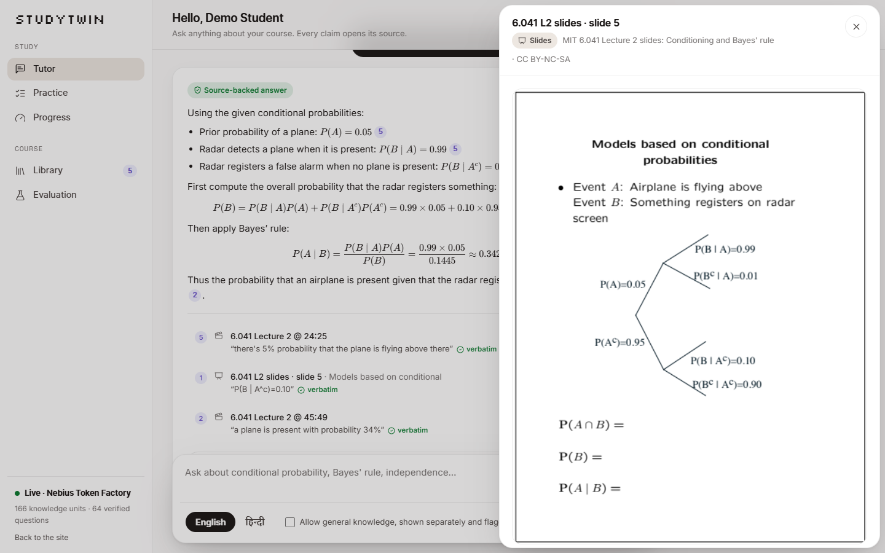
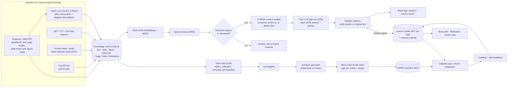

# StudyTwin

**A tutor that shows its sources.** StudyTwin turns lecture videos, slide decks and textbook chapters into one
source-cited knowledge base, answers questions only from that material (every claim opens the exact page,
slide or video timestamp), and runs adaptive quizzes driven by a per-topic learner model.

Built for **Track D: Personalized Tutoring & Adaptive Learning** of the Multimodal AI Hackathon 2026
(KamandPrompt, IIT Mandi).

| | |
|---|---|
| Demo course | MIT OCW 6.041 *Probabilistic Systems Analysis* (Lecture 2 video, Lecture 1-3 slides) + OpenStax *Introductory Statistics* Ch. 3 (see [DATA.md](DATA.md)) |
| Models | Nebius Token Factory (open-weight models), local BGE-small embeddings, local faster-whisper |
| Context layer | [LLMSlim](https://pypi.org/project/llmslim/) (query-aware extractive compression with citations preserved) |
| Runs on | a laptop CPU; FastAPI + SQLite backend, React frontend (prebuilt, no Node needed to run) |
| Tests | 19 offline tests, no API key or network needed |



More screenshots (landing page, progress, practice, library, evaluation; desktop and 375px mobile) are in
[docs/screenshots](docs/screenshots).

---

## The problem

Students learn from lecture videos, slides and textbooks scattered across places. General chatbots answer
anything, with no link back to the course and no idea what the student already knows. A study companion
should (1) answer from the course material and show exactly where, (2) say so when the material does not
cover a question, and (3) aim practice at what the student has not learned yet.

## What it does (mapped to the Track D requirements)

| Requirement | How StudyTwin does it |
|---|---|
| **1a** Ingest videos, textbooks, slides without manual preprocessing | Upload any `.pdf`, `.pptx`, `.mp4/.mkv/.webm/.mov`, `.mp3/.wav/.m4a`, `.srt/.vtt` or a YouTube link. The file type picks the pipeline. Textbook vs slide PDFs are auto-detected; 2x2 "handout" slide pages are split into individual slides by detecting the slide frames. Video/audio is transcribed locally with faster-whisper (CPU). |
| **1b** Topics, concepts, prerequisites; every unit linked to its origin | Every knowledge unit stores its location: textbook printed page (+ section), slide number, or video start/end seconds. An LLM builds a topic map (7 topics, 14 subtopics, key concepts, prerequisite DAG) from a digest of all sources. |
| **1c** Tag every unit to topics and key concepts | Each unit is assigned to its closest subtopic (embedding similarity + key-concept boost) and tagged with the key concepts it mentions. |
| **1d** Use information from images, diagrams, figures | Embedded textbook figures are cropped from the rendered page; every slide is sent to a vision-language model (GLM-5.3 Flash) that transcribes equations and describes diagrams with every number and label. Descriptions become citable "figure" units (e.g. the radar probability tree, the kitten tree diagram). |
| **2a** Cited excerpts that open the exact page / slide / timestamp | Answers cite `[S#]` markers. Clicking one opens a viewer: the rendered textbook page with the quoted text highlighted, the slide crop, or the lecture video seeked to the second. Each citation carries a verbatim quote that is checked against the original unit text. |
| **2b** Decline or flag uncovered queries; separate outside knowledge | Two-stage refusal: low retrieval support is declined before any model call; otherwise the model must answer `not_covered` when the evidence is insufficient. Optional "general knowledge" is returned in a separate, labelled box, never mixed into the cited answer. |
| **3a** Quizzes and mock exams (MCQ, short, numerical) on chosen scope, tagged | Adaptive quizzes, fixed-blueprint mock exams and a cold-start diagnostic, over any set of topics. Every question has topic, subtopic, difficulty (1-3) and source units. |
| **3b** Verify correctness; avoid repeats | Questions are written by DeepSeek V4 Flash and solved **blind** by gpt-oss-120b (a different model family); MCQ letters / numbers (within tolerance) must agree, short-answer keys are checked against the sources. Near-duplicate stems (cosine >= 0.90) are rejected, and a student never sees a question twice while unseen ones remain (new ones are generated and verified on demand). |
| **3c** Cited feedback and a post-assessment report | Every graded answer returns the worked solution with clickable source citations and, for a wrong MCQ option, the misconception that option encodes. The report shows per-topic score, mastery before/after, weak topics, misconceptions and what to review (with source links). |
| **4a** Per-topic mastery updated after every quiz and conversation | Bayesian Knowledge Tracing per topic (slip by difficulty, guess by question type, partial credit). Tutor turns give soft evidence: the model labels the student's message as misconception / confusion / understanding. A memory half-life drives spaced review. |
| **4b** New students | Intake self-rating per topic sets the BKT priors, then a diagnostic quiz with one question per topic. |
| **5a/b** RAG evaluation with a standard framework on a team-built test set | RAGAS 0.4 (faithfulness, answer relevancy, context precision, context recall) plus source-location metrics on 34 questions with known page/slide/timestamp and 10 off-material questions. |
| **5c** Personalization with simulated students | 4 student profiles x 40 students x 6 sessions using the real question bank: mastery gains, BKT tracking error and question repetition rate, vs two random baselines. |
| **6** Optional | Course flow map, flashcards for weak topics, study schedule to exam day with forgetting curves, Hindi answers (Devanagari, citations unchanged; Devanagari questions are translated for retrieval), audio tutoring in the browser (answers read aloud, voice questions in English or Hindi via the Web Speech API). |

## Architecture



**Code map**

| Path | What it does |
|---|---|
| `studytwin/ingest/` | `pdf.py` (textbook + slides, frame splitting, figure crops, highlight lookup), `video.py` (Whisper, captions, YouTube, 1-minute windows), `figures.py` (vision descriptions), `pipeline.py` (dispatch, PPTX, storage) |
| `studytwin/retrieval.py` | BM25 + dense (BGE-small) hybrid search fused with reciprocal rank fusion |
| `studytwin/context.py` | LLMSlim evidence budgeting with citation markers re-attached after compression |
| `studytwin/tutor.py` | Grounded answers, refusal gate, citation normalisation, quote verification, conversation signals |
| `studytwin/topics.py` | Topic map, unit tagging, course-map data |
| `studytwin/assessment.py` | Question generation, cross-model verification, dedup, adaptive selection, grading, reports |
| `studytwin/learner.py` | BKT, partial credit, soft conversation evidence, retention, topic allocation, difficulty choice |
| `studytwin/revision.py` | Flashcards and the study schedule |
| `studytwin/eval/` | `rag_eval.py` (RAGAS + source-location metrics), `simulate.py` (simulated students), `extras.py` (ASR word error rate, bank stats) |
| `studytwin/api.py` | FastAPI endpoints; serves the built React app |
| `frontend/` | React 18 + TypeScript + Tailwind v4 + Motion, built on the shared hackathon design kit (`frontend/src/kit`) |
| `eval/testset.json` | The team-built test set (questions, reference answers, gold source locations) |
| `eval/results/` | Measured results used by the README and the app's Evaluation page |

## Grounding method

1. **Retrieve.** The question (plus the previous question for short follow-ups) is matched against all
   units with BM25 and BGE-small embeddings; the two rankings are fused with reciprocal rank fusion (top 8).
2. **Gate.** If the best dense similarity is below 0.55 the question is declined without calling a model,
   and the closest material is named.
3. **Budget with LLMSlim.** The 8 evidence blocks are compressed with `llmslim.compress_documents`
   (query-aware, extractive, budget shared across blocks by relevance) to about 1,000 tokens. The `[S#]`
   marker and the location header are added *after* compression, so citations cannot be lost, and because
   the compression is extractive every kept sentence still exists verbatim in the source (checked on every
   answer and shown as `verbatim_sentences`).
4. **Answer.** The tutor model must return JSON: status (`answered` / `partial` / `not_covered`), a markdown
   answer where every factual sentence ends with `[S#]`, one verbatim quote per cited source, optional
   flagged outside knowledge, and a label for the student's message.
5. **Validate.** Citation styles are normalised, citations to non-existent sources are dropped, quotes are
   matched against the original unit text (`exact` / `close match` / `unverified`), and uncited sentences are
   counted. The UI opens each citation at its page (with the quote highlighted), slide or timestamp.

## Learner model

* **BKT per topic.** P(correct | known) = 1 - slip, with slip 0.05 / 0.10 / 0.18 for difficulty 1 / 2 / 3;
  P(correct | unknown) = guess, with guess 0.25 (MCQ), 0.10 (short), 0.05 (numerical). After the posterior,
  P(learn) = 0.12 is applied. Partial credit mixes the correct and incorrect posteriors.
* **Conversation evidence.** Misconception (weight 0.5), confusion (0.2) and correct understanding (0.3)
  move the estimate part of the way to the full BKT update.
* **Cold start.** Intake ratings 1-5 map to priors 0.10-0.70; the diagnostic then asks one medium question
  per topic.
* **Adaptive selection.** Priority = 1 - (mastery x predicted retention), halved when a prerequisite is
  still below 0.4. A quiz concentrates on the three highest-priority unmastered topics, and each question's
  difficulty is chosen so the predicted success rate is closest to 70%.
* **Spaced review.** Each topic keeps a memory half-life (doubles after a correct answer, halves after a
  wrong one); predicted retention below 80% marks it due and feeds the study schedule.

## Evaluation (measured)

All numbers below come from files in `eval/results/` and are reproducible with the commands shown.

### RAG pipeline, team-built test set (`python -m studytwin.eval.rag_eval`)

34 in-scope questions (13 textbook, 14 slides, 7 lecture video; 7 need a figure or diagram) with gold
page / slide / timestamp locations, and 10 off-material questions. Tutor `openai/gpt-oss-120b`; RAGAS judge
`deepseek-ai/DeepSeek-V4-Flash-0731` (a different model); fresh model calls, single run.

| Metric | LLMSlim on (default) | Full context |
|---|---|---|
| RAGAS faithfulness | **0.97** (n=26) | 0.98 (n=25) |
| RAGAS answer relevancy | **0.92** (n=33) | 0.91 (n=34) |
| RAGAS context precision (LLM, with reference) | **0.84** | 0.82 |
| RAGAS context recall (LLM, with reference) | **0.96** | 0.97 |
| Gold source retrieved in top 8 (hit@8) | 100% | 100% |
| Mean reciprocal rank of the gold source | 0.88 | 0.88 |
| Answers citing a gold location | **100%** (33/33 answered) | 94% |
| Quotes found in the cited source | 98% (89% exact) | 100% (88% exact) |
| Off-material questions declined | **100%** (10/10) | 100% |
| In-scope questions wrongly declined | 2.9% (1/34) | 0% |
| Evidence tokens per question (LLMSlim estimate) | **1,034** | 1,658 (-38%) |
| Prompt tokens per question (provider-reported) | **1,576** | 2,258 (-30%) |
| Median latency | 1.73 s | 1.61 s |

Read with care: the test set is small and was written by us (AI-assisted, checked against the extracted
text); RAGAS means exclude the few answers the judge could not score (n shown); an earlier full run gave
citation accuracy 0.85 vs 0.76 and faithfulness 0.91 vs 0.99, so differences of a few points between the two
configurations are within run-to-run noise. The consistent effect of LLMSlim is a 30-38% smaller prompt with
no measured loss in grounding. Of the 10 off-material questions, 3 were declined by the retrieval gate and 7
by the model.

### Personalization, simulated students (`python -m studytwin.eval.simulate`)

4 profiles (novice, uneven, strong, slow learner) x 40 students x 6 sessions of 8 questions, drawn from the
real verified bank (64 questions, 7 topics). Hidden knowledge follows a BKT-style process (learning from
practice, halved when a prerequisite is unknown, 4% forgetting per session).

| Policy | Mean true-mastery gain | BKT error, session 1 -> 6 | Repeated questions |
|---|---|---|---|
| **StudyTwin adaptive** | **+32 pts** | 0.36 -> 0.18 | **0%** |
| Random, no repeats | +27 pts | 0.31 -> 0.17 | 0% |
| Random with repeats | +24 pts | 0.32 -> 0.18 | 30% |

The adaptive policy has the largest gain for every profile (novice +54 vs +47, uneven +36 vs +31,
strong +12 vs +11, slow learner +28 vs +19 points against random-no-repeat), and the learner model's error
halves as evidence accumulates. Caveat: simulated learners follow the same family of model the tutor
assumes, so this shows the policy works as designed, not real learning gains.

### Other measurements (`python -m studytwin.eval.extras`)

* **Lecture transcription:** faster-whisper `small` (int8, CPU) has a **4.6% word error rate** against the
  official MIT OCW captions of Lecture 2 (7,098 reference words); the 51-minute lecture took 8.8 minutes on a
  12-thread laptop CPU (5.8x real time).
* **Question bank:** 66 questions generated, **64 (97%) passed blind cross-model verification**, 2 rejected,
  and at least 8 near-duplicates blocked before storage. Two models agreeing is not proof of correctness.
* **Cost:** all cached app calls (ingestion vision, topic map, question bank, tutor answers) total about
  0.47M tokens on Nebius Token Factory, roughly US$0.1-0.3 at catalog prices; RAGAS judging adds a similar
  order of magnitude per run.

## Setup

Requirements: Python 3.11 or 3.12 (tested on 3.12, Windows 11). Node is only needed to rebuild the frontend.

```bash
git clone https://github.com/Thanatos9404/StudyTwin.git && cd StudyTwin
python -m venv .venv
# Windows: .venv\Scripts\activate    macOS/Linux: source .venv/bin/activate
pip install torch --index-url https://download.pytorch.org/whl/cpu   # CPU-only PyTorch, small download
pip install -r requirements.txt
cp .env.example .env    # then paste your Nebius Token Factory key (see KEYS_NEEDED.md)
```

Without a key everything still runs in **offline mode**: answers are extractive (LLMSlim picks the most
relevant cited sentences), topics come from textbook headings, and questions are template cloze MCQs.

## Run

```bash
# 1. Build the demo knowledge base (5 sources, topic map, verified question bank).
#    Uses the committed PDFs and captions; add the lecture video for Whisper transcription:
python scripts/fetch_demo_data.py          # optional: downloads the 118 MB lecture video (archive.org)
python scripts/seed_demo.py --fresh        # ~5 min ingestion (incl. vision) + ~30 min question bank (cached afterwards)
                                           # (--no-bank to skip questions; --captions to use the OCW captions instead of Whisper)

# 2. Start the app
uvicorn studytwin.api:app --port 8765
# open http://localhost:8765 (landing page) -> "Open the app"
```

The first question after a restart takes longer while the embedding model loads (the server warms it up in
the background at start-up). Typical answers take 2-10 s, most of it the model call.

Use **Library** to add your own material (any PDF, PPTX, video/audio, captions, or a YouTube link).

Frontend development (optional): `cd frontend && npm install && npm run dev` (proxies the API on :8765);
`npm run build` writes `frontend/dist`, which FastAPI serves.

## Tests and evaluation

```bash
python -m pytest -q                         # 19 offline tests (no key, no network), ~30 s
pip install -r requirements-eval.txt        # RAGAS + LangChain OpenAI-compatible client
python -m studytwin.eval.rag_eval           # RAGAS + location metrics (uses Nebius credits)
python -m studytwin.eval.rag_eval --no-ragas  # location + refusal metrics only
python -m studytwin.eval.simulate           # simulated students (no model calls)
python -m studytwin.eval.extras             # ASR word error rate, question-bank stats
```

RAGAS telemetry is disabled (`RAGAS_DO_NOT_TRACK=true`). All model calls go to Nebius Token Factory's
OpenAI-compatible endpoint; nothing is sent to OpenAI or Anthropic APIs.

## AI tools used

This project was built with **Claude Code (Anthropic, Claude Opus 5.5)** as an AI pair programmer. It wrote
most of the code (backend, frontend, tests, evaluation scripts) and the first drafts of the documentation,
under Yashvardhan's direction and review. Specifically AI-assisted: all Python modules in `studytwin/`, the
React app in `frontend/src/app` and `frontend/src/landing`, `tests/`, `scripts/`, the test-set questions in
`eval/testset.json` (checked against the extracted source text), and this README. The shared UI kit in
`frontend/src/kit` was also produced with Claude Code for Yashvardhan's hackathon builds. The runtime models
(gpt-oss-120b, DeepSeek V4 Flash, GLM-5.3 Flash, BGE-small, faster-whisper) are part of the product, not
development tools. LLMSlim is Yashvardhan's own open-source library.

## Limitations

* The demo course is one topic area (conditional probability, Bayes' rule, independence). Topic maps for very
  large courses would need chunked map-reduce over the digest.
* Lecture video frames are not analysed (the low-resolution OCW video mostly shows the board); visual content
  comes from slides and textbook figures.
* Math extracted from PDFs can be garbled; vision transcription fixes slides, but textbook equations rely on
  the PDF text layer.
* BKT tracks major topics, not individual skills; parameters are hand-set, not fitted to student data.
* The personalization results are from simulated students, not a user study.
* Single-user local app: no authentication; the SQLite workspace holds all students.
* The tutor occasionally declines a question it could answer (1 of 34 in the final run), and RAGAS judges
  occasionally fail to score an answer.

## Licence

Code: MIT ([LICENSE](LICENSE)). Course material in `data/demo/` keeps its original licences (CC BY 4.0 and
CC BY-NC-SA); see [DATA.md](DATA.md). Fonts are OFL, self-hosted.
